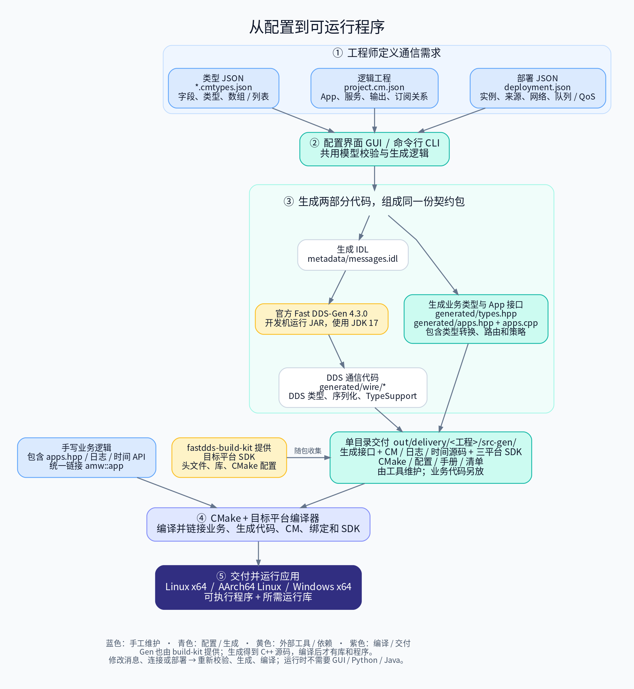
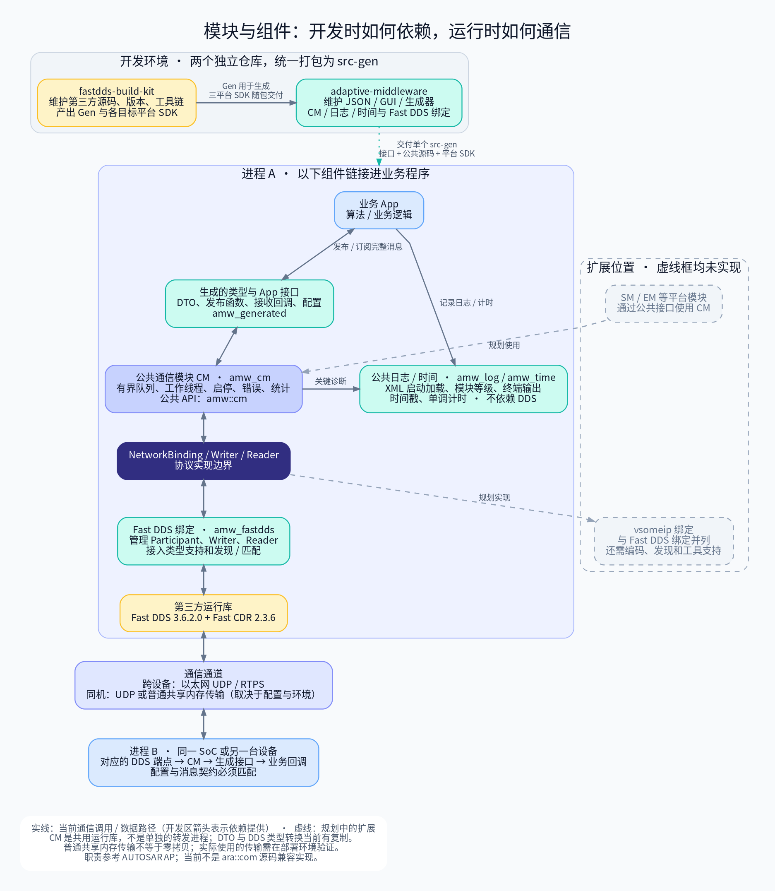

# Adaptive Middleware

这是一个 C++17 通信中间件和配套配置工具。工程师用 JSON 定义消息，在界面中配置 App 的输出和输入，然后生成 IDL、C++ 消息类型、App 通信接口及 CMake 文件。业务程序通过这些接口发布、订阅完整消息。

目前版本为 0.2.0，底层使用 Fast DDS 3.6.2.0、Fast CDR 2.3.6 和 Fast DDS-Gen 4.3.0。Linux 和 Windows 已验证基本收发，ARM 已验证交叉编译，具体范围见 [验证记录](docs/VALIDATION.md)。

继续维护本仓库或在此目录新开 AI 对话，请先读 [开发交接与前情提要](DEVELOPMENT_CONTEXT.md) 和 [仓库维护约定](AGENTS.md)。

## 第一次使用，从哪里开始

| 你要完成的事 | 阅读顺序 |
|---|---|
| 拿到仓库后先生成一份 src-gen | [环境准备与首次生成](docs/GETTING_STARTED.md) |
| 为自己的消息写类型文件 | [JSON 类型编写指南](docs/JSON_FORMAT.md) |
| 在界面中配置 App、保存工程并交给同事 | [可视化配置操作指南](docs/QUICKSTART_GUI.md) |
| 配置 QoS 默认值、输入输出策略和网络参数 | [QoS 配置指南](docs/QOS.md) |
| 不开界面，用脚本或 CI 生成 | [命令行参考](docs/CLI.md) |
| App 开发人员集成与调用接口 | [CM 应用开发手册](docs/app-guide/README.md) |
| 开发中间件、检查 Git 提交范围 | [团队开发与提交](docs/CONTRIBUTING.md) |
| 团队组织生成结果与交付 | [业务接入与产物交付](docs/INTEGRATION.md) |
| 配置终端日志、指定运行时 XML、使用时间戳和计时 | [日志与时间工具](docs/app-guide/LOGGING.md) |
| 构建 Linux / Windows / ARM 库和程序 | [构建指南](docs/BUILD.md) |
| 生成失败、编译失败或收不到消息 | [常见问题与排查](docs/TROUBLESHOOTING.md) |

第一次使用建议先跑通仓库自带示例，再替换成自己的消息。完整文档导航和几个常用术语见 [docs/README.md](docs/README.md)。

## 仓库负责什么

配置如何变成程序，可以顺着这张图从上往下看：



[放大查看 SVG](docs/diagrams/generation-flow.svg)


每个项目只交付一个完整 **src-gen/**，包含生成接口、公共 CM/日志/时间源码、Linux x64 / ARM64 Linux / Windows x64 SDK 和通用手册。根目录自动附带 `<工程ID>.amw.json`，可通过工作台“打开工程”恢复本次生成使用的完整配置。应用通过一个 CMake 入口接入，不再另行安装中间件和 DDS SDK。ARM 工具链路径可在编译时指定。

生成代码和编译程序是两个步骤：生成完成会得到 C++ 源文件；要得到 Linux 库、Windows .lib/.dll 或可执行程序，使用包内对应平台 SDK，并准备匹配的编译器。

`fastdds-build-kit` 是另一个独立仓库，负责从第三方源码构建 SDK 和生成器。本仓库通过 `config.local.json` 引用它提供的 SDK 安装目录、Gen JAR 和 Java 路径。也可以使用同事交付的相同版本产物，不要求两个仓库放在固定位置。

## 模块之间怎样配合

下图把开发工具、进程内部组件和进程间通信分开。实线表示当前的依赖或通信路径，灰色虚线框表示尚未实现的扩展。



[放大查看 SVG](docs/diagrams/component-map.svg) · [架构说明](docs/ARCHITECTURE.md) · [图片源文件与更新方法](docs/diagrams/README.md)

## 已经配置好环境时的常用命令

下面在仓库根目录执行；首次使用需先完成 [配置步骤](docs/GETTING_STARTED.md)。

```bash
./amw doctor
./amw validate
./amw generate
./amw gui
```

未指定工程时，命令加载 `examples/demo/project.cm.json`。CLI 和 GUI 默认按工程 ID 生成到 `out/delivery/<工程ID>/src-gen/`，示例工程为 `out/delivery/demo/src-gen/`。GUI 草稿保存到 `out/editor/<工程ID>/`；生成前页面显示完整目标路径，可在“生成位置设置”修改生成根目录。

GUI 顶部工程栏持续显示当前工程名称和保存状态，并提供新建、打开和导出工程包按钮；类型库固定高度、独立滚动，点击类型查看结构与引用关系。主工作区切换应用配置和数据流图，图中支持缩放、点选查看消息以及移除连接。图表示配置关系，具体操作见 [界面指南](docs/QUICKSTART_GUI.md)。

## 接入自己的应用

业务代码包含生成的 `apps.hpp`，通过 App 类发布消息、注册接收回调。一个 App 实例对应一组配置好的通信端点，业务不需要自行创建 DDS Participant 或 DataWriter。

面向 App 开发者的通用手册见 [CM 应用开发手册](docs/app-guide/README.md)，详细介绍 SDK 集成、接口调用、线程、生命周期与错误处理。CLI/GUI 每次生成都将同一份手册原样附带到 `guide/`，不按工程或 App 改写；从 src-gen 根目录的 README 可进入。

原有的 CMake 接入步骤和接口命名说明见 [业务接入指南](docs/INTEGRATION.md)。实际代码例子在 [producer.cpp](examples/demo/producer.cpp) 和 [consumer.cpp](examples/demo/consumer.cpp)。发送返回成功表示已进入本中间件队列，接收者是否收到、业务是否处理完成是后续阶段；线程和停止行为见 [运行说明](docs/RUNTIME.md)。

## 团队维护约定

- 公共示例和测试数据随中间件提交；个人业务配置放 local/ 或独立业务仓库，需要长期保存时在业务仓库版本管理。不能只留界面的临时草稿。
- 生成目录完全由工具维护，手写业务代码放在其他目录；交付时保留整个 src-gen 目录及其清单。
- 本机路径保存在忽略的 `config.local.json`。`out/`、虚拟环境和缓存也不进入本仓库 Git。
- 改消息或部署后，重新校验、生成和编译，保持收发双方的约定一致。

架构借鉴 AUTOSAR AP 的 CM 职责，当前 API 命名空间为 `amw::cm`，不声明 ara::com 源码兼容或完整 AP 符合性。终端日志和时间工具已实现，独立于 DDS；vsomeip 绑定尚未实现，安排见 [路线图](docs/ROADMAP.md)。
